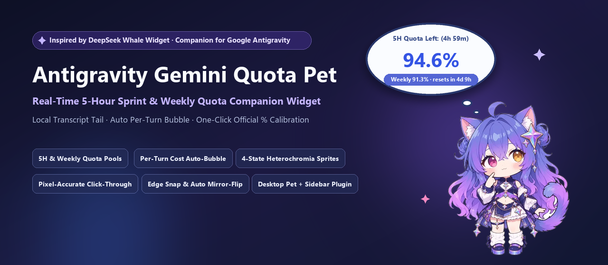
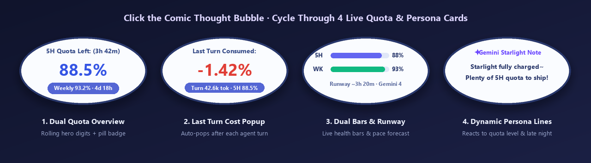
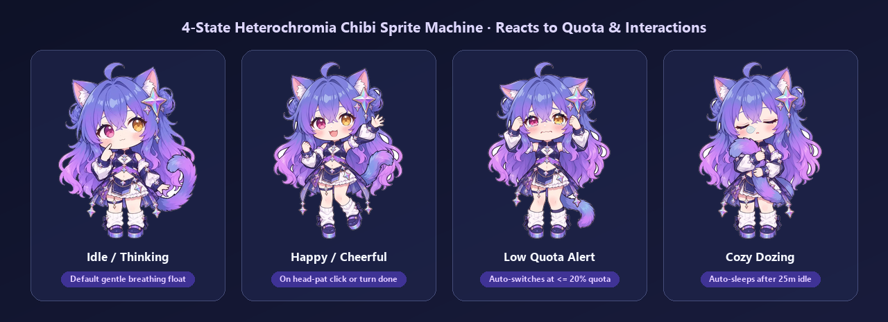
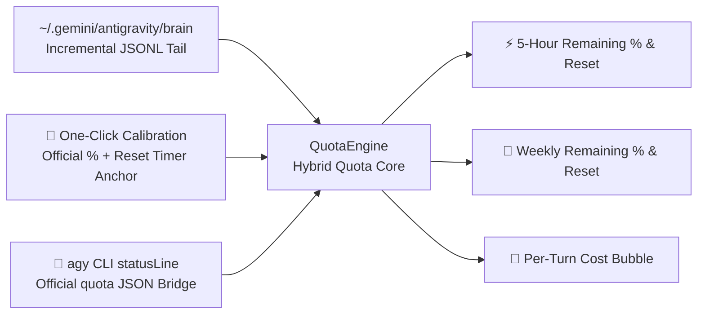

<div align="center">



<br />

# ✦ Antigravity Gemini Quota Pet

**Inspired by `DeepSeek-Balance-Whale-Widget` · A Cute Heterochromia Gemini Catgirl Companion for Google Antigravity**  
Real-time **5-Hour Rolling Quota**, **Weekly Quota** & **Per-Turn Consumption** Monitor · Runs as both a **Transparent Desktop Floating Pet** and a **Native Antigravity Sidebar Plugin**

🌐 **English (Default)** | **[简体中文文档 (Chinese README)](README_zh-CN.md)**

[](https://github.com/fornemadepi/Antigravity-Gemini-Quota-Pet)
[](https://antigravity.google)
[](https://www.electronjs.org/)
[](#-%E9%9A%90%E7%A7%81%E4%B8%8E%E5%AE%89%E5%85%A8-privacy--security)
[](LICENSE)

</div>

---

## ⚡ Quickest Way to Get It (Copy & Paste to Antigravity!)

You don't even need to open a terminal manually — **simply copy the prompt below and send it directly to Google Antigravity, and you will get the plugin automatically!**  
*(直接复制下方这段话发给 Antigravity，即可自动获得插件与桌宠！)*

**English Prompt:**
```text
Please clone https://github.com/fornemadepi/Antigravity-Gemini-Quota-Pet.git, run `npm install` and `npm run install:plugin`, and set up the Gemini Quota Pet plugin and desktop launcher for me.
```

**中文提示词（直接复制发给 Antigravity 即可获得插件）：**
```text
请帮我克隆 https://github.com/fornemadepi/Antigravity-Gemini-Quota-Pet.git ，安装依赖并运行 npm run install:plugin ，为我安装好 Gemini 额度桌宠插件与桌面启动器。
```

Once installed, click the **`+` menu in the top-right Auxiliary Pane → `Gemini 桌宠`** inside Antigravity (or double-click `启动桌宠(无黑框).vbs` for the standalone transparent Windows desktop pet)!

---

## 🌟 Overview

In the DeepSeek community, **[@MeteorNOX](https://github.com/MeteorNOX)**'s open-source **[DeepSeek-Balance-Whale-Widget](https://github.com/MeteorNOX/DeepSeek-Balance-Whale-Widget)** became a beloved coding companion thanks to its comic thought bubbles, per-turn cost popups, and squishy interactive physics.

In **Google Antigravity**, model usage is governed by **5-Hour Rolling Sprint Quotas** and **7-Day Weekly Quotas** rather than cash balances. Opening `Settings → Models` repeatedly breaks coding flow and makes it hard to tell how much quota a complex multi-step turn just consumed.

**Antigravity Gemini Quota Pet** brings that joyful desktop companion experience to Google Antigravity with a custom **Gemini-personified heterochromia catgirl**, swapping cash balance tracking for real-time **Remaining 5-Hour / Weekly Quota** monitoring:

<table>
<tr>
<td width="36%" align="center">
  
  <br />
  <sub><b>Frameless Transparent Desktop Pet on Windows</b><br />(Pixel-accurate mouse click-through — never blocks your editor)</sub>
</td>
<td width="64%" align="center">
  
  <br />
  <sub><b>Gemini Catgirl Character Turnaround Sheet</b><br />(Pink/Amber Heterochromia · 4-Point Gemini Star Hairpin · Nebula Tail)</sub>
</td>
</tr>
</table>

---

## ✨ Key Features

### 1. 🫧 Classic Comic Thought Bubble · 4-in-1 Interactive Cards

Left-click the comic thought bubble to cycle smoothly through 4 live information & dialogue cards:

<p align="center">
  
</p>

- **① Dual Quota Overview (Default)**: Smooth rolling hero digits showing your **5-Hour Remaining Quota %** and compact reset countdown, paired with a bottom indigo pill badge for **Weekly Remaining Quota %** (primary/secondary metrics can be swapped anytime).
- **② Per-Turn Usage Popup (Auto-Pop)**: Incrementally tails local Antigravity conversation transcripts and **automatically pops up a cost bubble** with starlight particles and a soft chime right after each agent turn finishes.
- **③ Dual Progress Bars & Runway Forecast**: Displays health-colored `5H` & `Weekly` bars, today's total tokens, and an active burn-rate runway forecast (`~Xh Ym left`).
- **④ Dynamic Gemini Starlight Quotes**: Context-aware cheerful lines, low-quota reminders, and late-night care messages based on your current quota level and local time.

---

### 2. 🎭 4-State Chibi Expression Machine & Desktop Physics

<p align="center">
  
</p>

- **Automatic Mood Transitions**: Gently floats in **Idle** state; switches to **Happy** when poked/petted or when a turn finishes; automatically switches to teary-eyed **Low Quota (`<= 20%`)** when either your 5-hour or weekly quota runs low; dozes off into **Sleep** after 25 minutes of inactivity.
- **Pixel-Accurate Alpha Click-Through & Zero Top White Bar**: Offscreen canvas alpha hit-testing lets clicks pass straight through transparent areas to underlying windows, while Win32 native region clipping (`setShape`) completely eliminates Windows 11 DWM inactive caption artifacts.
- **Magnetic Edge Snapping & Auto Mirror-Flip**: Drag anywhere across monitors; snaps cleanly to screen edges and flips horizontally when docked on the left edge so the speech bubble always stays inside the screen.
- **Jelly Squish Physics & Zero-Asset Web Audio SFX**: Poking the character triggers an elastic squash-and-stretch bounce, floating Gemini stars (`✦` `✧` `♡`), and synthesized `Web Audio API` chimes (zero external audio files required).
- **Dual Surfaces**: Run as a **Standalone Always-on-Top / Window-Following Desktop Pet** (`65%–175%` scale) OR as a **Native Antigravity MCP App Plugin** inside the Side Pane.

---

## 🧠 Hybrid 3-in-1 Quota Engine

Because the Antigravity desktop app does not expose an unauthenticated external REST endpoint for account quotas, `src/quota-engine.js` combines three 100%-local mechanisms:



1. **Zero-Config Rolling Window**: Immediately reads recent token metadata from `~/.gemini/antigravity/brain/*/.system_generated/logs/transcript.jsonl` via incremental byte offsets (`< 5ms` per poll) to estimate rolling 5-hour and 7-day usage out of the box.
2. **One-Click Official % Calibration (Recommended)**: Open the Settings & Calibration panel (`Right-Click → 🎯 打开额度校准与设置面板`) and enter your current percentages and reset timers from `Antigravity → Settings → Models` once. Subsequent turns deduct proportionally in real time, and **once the countdown hits `0`, the window automatically refills to `100%` for the next cycle!**
3. **`agy` CLI Auto-Bridge**: Includes `scripts/agy-statusline-bridge.js` — configure `/statusline` once in Antigravity CLI to automatically stream official `quota` JSON snapshots straight to the pet.

---

## 🚀 Manual Installation & Launch

### Prerequisites
- **OS**: Windows 10 / 11 (macOS / Linux also supported via `npm start`)
- **Runtime**: **[Node.js](https://nodejs.org/) 20+** (Node.js 22 / 24 LTS recommended)

### Setup

```powershell
git clone https://github.com/fornemadepi/Antigravity-Gemini-Quota-Pet.git
cd Antigravity-Gemini-Quota-Pet
npm install
```

| Mode | How to Launch | Best For |
| :--- | :--- | :--- |
| **A. Silent Desktop Floating Pet (Recommended)** | Double-click **`启动桌宠(无黑框).vbs`** (no console window; create a shortcut in `shell:startup` for auto-start) | Always-on-top desktop companion or following the Antigravity window |
| **B. Auto-Setup Batch / CLI** | Double-click **`启动桌宠.bat`** or run `npm start` | First-time auto dependency check or terminal launch |
| **C. Native Antigravity Sidebar Plugin** | Double-click **`安装Antigravity侧边栏插件.bat`** or run `npm run install:plugin` | Open inside Antigravity (`+` menu → `Gemini 桌宠`) + 1-click button to pop out the desktop pet |

---

## 🔒 Privacy & Security

- **100% Local, Zero Telemetry**: Makes zero network requests to external analytics or third-party servers.
- **Read-Only Token Metadata**: Reads only token counts and model IDs from local transcripts — never reads or transmits prompt text, API keys, cookies, or OAuth credentials.

---

## 💖 Acknowledgments (致谢与鸣谢)

This project stands on the shoulders of the open-source community. Sincere thanks to the original creator, maintainers, contributors, and community supporters of the **DeepSeek Balance Whale Widget** ecosystem *(listed from the upstream project's official acknowledgments)*:

- 🐋 **Original Creator & Inspiration**: Huge thanks to **月匠 ([@MeteorNOX](https://github.com/MeteorNOX))** for creating and open-sourcing **[MeteorNOX/DeepSeek-Balance-Whale-Widget](https://github.com/MeteorNOX/DeepSeek-Balance-Whale-Widget)**. The signature comic thought bubble, per-turn consumption popup, squishy interaction, and edge-snapping mirror flip are all directly inspired by MeteorNOX's wonderful design.
- 🖥️ **Desktop Port & Cross-Platform Pioneers**:
  - **[@Yang-huai406](https://github.com/Yang-huai406)** for maintaining the standalone Codex desktop port **[Codex-Whale-Public](https://github.com/Yang-huai406/Codex-Whale-Public)** and pioneering window-following & balance calibration designs;
  - **[@1llysviel](https://github.com/1llysviel)** for contributing the upstream macOS transparent floating window adaptation (PR [#128](https://github.com/MeteorNOX/DeepSeek-Balance-Whale-Widget/pull/128)).
- 🛠️ **Upstream Code & PR Contributors**:
  - **[@ELFsay](https://github.com/ELFsay)** (multi-window subscription quota & compact reset countdown design, PR [#99](https://github.com/MeteorNOX/DeepSeek-Balance-Whale-Widget/pull/99))
  - **[@Jy-EggRoll](https://github.com/Jy-EggRoll)** (task state awareness & sound notification cues, PR [#161](https://github.com/MeteorNOX/DeepSeek-Balance-Whale-Widget/pull/161))
  - **[@ztzpro](https://github.com/ztzpro)** (standard plugin bundle architecture, PR [#1](https://github.com/MeteorNOX/DeepSeek-Balance-Whale-Widget/pull/1))
  - **[@under-the-ocean](https://github.com/under-the-ocean)** (automated release & publishing workflows, PR [#6](https://github.com/MeteorNOX/DeepSeek-Balance-Whale-Widget/pull/6) / [#7](https://github.com/MeteorNOX/DeepSeek-Balance-Whale-Widget/pull/7))
  - **[@21253soursweetlemon](https://github.com/21253soursweetlemon)** (fallback quotes, scrollbar avoidance & anchor position memory foundation, PR [#16](https://github.com/MeteorNOX/DeepSeek-Balance-Whale-Widget/pull/16) / [#18](https://github.com/MeteorNOX/DeepSeek-Balance-Whale-Widget/pull/18))
  - **[@fangbm](https://github.com/fangbm)** (per-turn cost bubble fixes, multi-currency awareness & automated changelogs, PR [#15](https://github.com/MeteorNOX/DeepSeek-Balance-Whale-Widget/pull/15) / [#19](https://github.com/MeteorNOX/DeepSeek-Balance-Whale-Widget/pull/19) / [#31](https://github.com/MeteorNOX/DeepSeek-Balance-Whale-Widget/pull/31) / [#33](https://github.com/MeteorNOX/DeepSeek-Balance-Whale-Widget/pull/33) / [#46](https://github.com/MeteorNOX/DeepSeek-Balance-Whale-Widget/pull/46))
  - **[@xiaolinnnnnnn](https://github.com/xiaolinnnnnnn)** (Windows desktop exploration, PR [#26](https://github.com/MeteorNOX/DeepSeek-Balance-Whale-Widget/pull/26))
- 🤝 **Upstream Community Bug Hunters, Testers & Supporters**:
  - Special thanks to **[@yybai25](https://github.com/yybai25)**, **[@0Sakura721](https://github.com/0Sakura721)**, **[@VaeKaras](https://github.com/VaeKaras)**, **[@MengLs1620](https://github.com/MengLs1620)**, Bilibili user **「星丶白羽莲」**, and all the enthusiastic **QQ group members and community users** whose bug reports, root-cause analyses, and feedback made the original Whale Widget ecosystem thrive!

---

## 📄 License & Disclaimer (许可与免责声明)

- **Code & Documentation**: Licensed under the **[MIT License](LICENSE)**.
- **Character Art & Visual Assets**: Provided *as-is* solely for running and displaying this companion widget (not covered under MIT code relicensing). See **[PROVENANCE.md](PROVENANCE.md)** for details.

> **⚠️ Hobby Project Disclaimer / 免责与侵权联系声明**
>
> **EN:** This project was created purely out of personal interest and enthusiasm by the author together with **Google Antigravity** (non-commercial fan/hobby creation). If there is any copyright infringement or any other inappropriate content or behavior, please contact the author via [GitHub Issues](https://github.com/fornemadepi/Antigravity-Gemini-Quota-Pet/issues) and we will promptly rectify or remove the relevant content.
>
> **中文：** 本项目由本人和 **Antigravity** 完全凭借个人兴趣而创立（非商业性质爱好者项目）。如有侵权或其他不当行为，请通过本仓库 [Issue](https://github.com/fornemadepi/Antigravity-Gemini-Quota-Pet/issues) 联系作者进行整改和删除。
