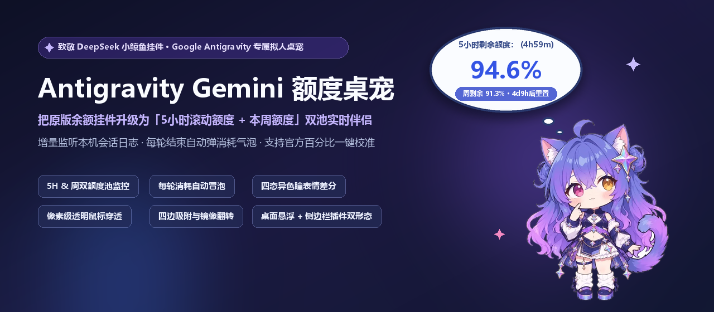
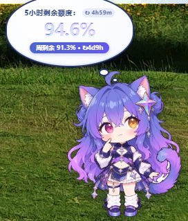
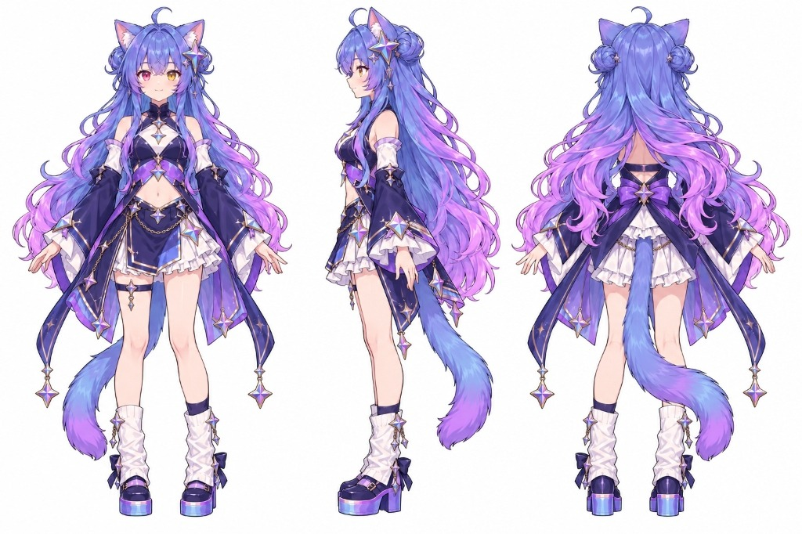
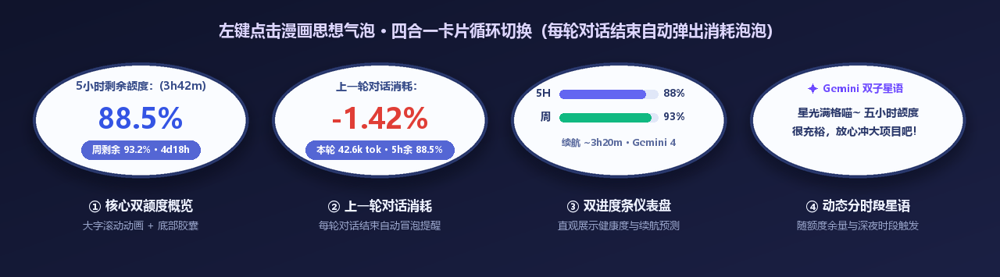
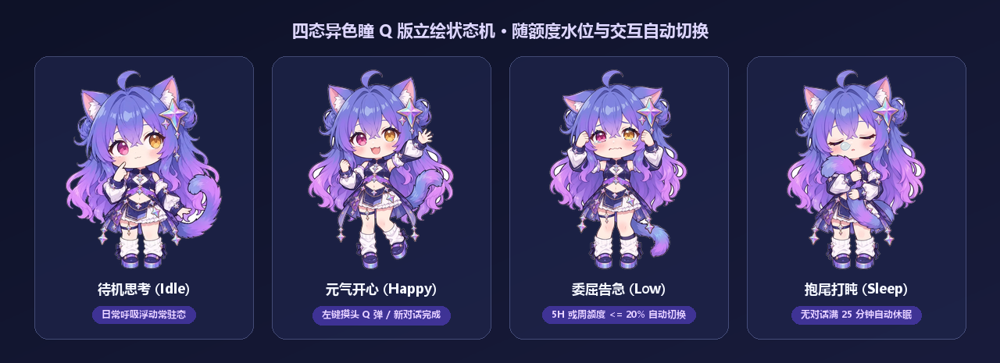
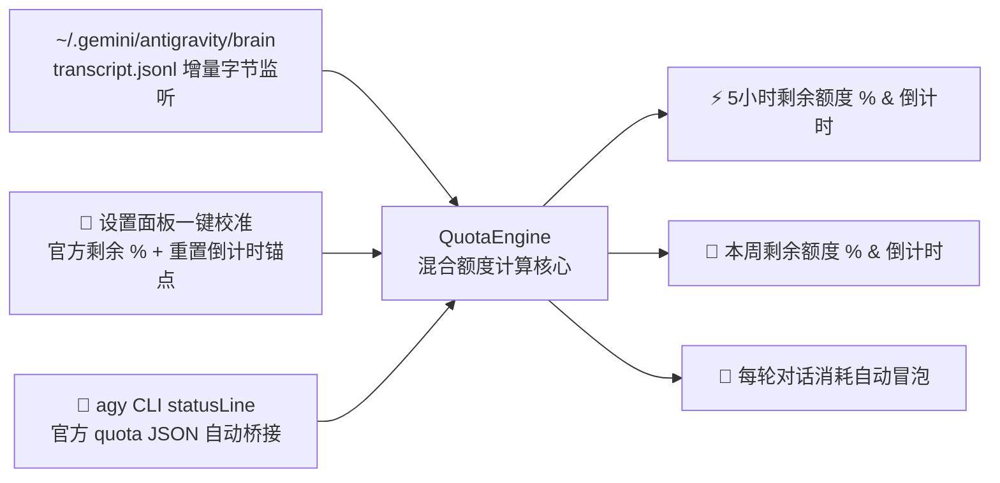
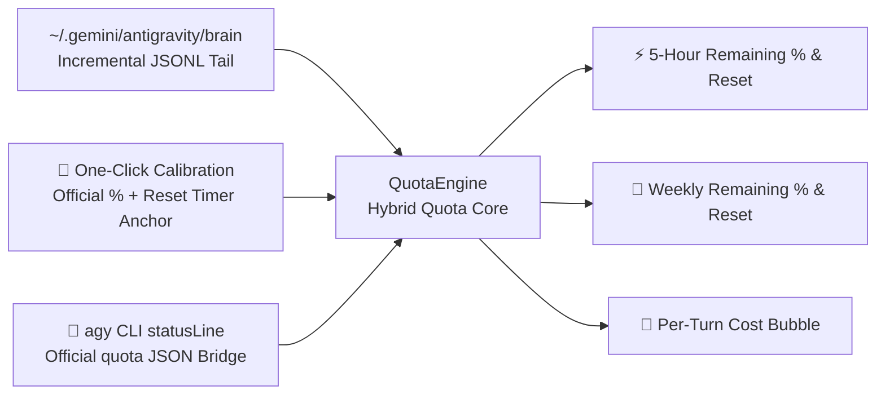

<details name="lang-switch">
<summary>🌐 <b>点击此处直接将当前页面切换为「简体中文」 (Click to switch current page to Simplified Chinese)</b></summary>

<br />

<p align="center">
  
</p>

<h1 align="center">✦ Antigravity Gemini 额度桌宠 (Gemini Quota Pet)</h1>

<p align="center">
  <b>专为 Google Antigravity 打造的双子星异色瞳猫娘陪伴桌宠</b><br />
  实时监控 <b>剩余 5小时滚动额度</b>、<b>本周总额度</b> 与 <b>每轮对话消耗</b> · 支持 <b>Windows 独立透明悬浮窗 + Antigravity 侧边栏插件</b> 双形态运行
</p>

<p align="center">
  
  
  
  
  
</p>

---

## ⚡ 最简获取方式（一句话复制给 Antigravity 自动安装！）

无需手动敲命令 —— **直接复制下面这段话发送给你的 Antigravity，即可自动获得插件与桌面悬浮宠：**

```text
请帮我克隆 https://github.com/fornemadepi/Antigravity-Gemini-Quota-Pet.git ，安装依赖并运行 npm run install:plugin ，为我安装好 Gemini 额度桌宠插件与桌面启动器。
```

Antigravity 执行完成后，点击界面右上角辅助栏的 **`+` 号菜单 → 选择「Gemini 桌宠」** 即可在侧边栏常驻打开，面板内还可一键弹出独立透明的 Windows 桌面猫娘悬浮窗！

---

## 🌟 项目简介

在 **Google Antigravity** 开发环境中，模型使用采用 **「5小时活跃滚动额度（5-Hour Rolling Quota）+ 7天周基准额度（Weekly Quota）」** 双池共享机制。在沉浸式写代码时，频繁点开 `Settings → Models` 查看额度既打断心流，也很难直观感知单轮复杂任务消耗了多少配额。

为此，本项目以 **Gemini 双子星拟人化异色瞳猫娘** 为主角，为你提供漫画思想泡泡、每轮消耗自动提醒、Q 弹摸头反馈以及 **剩余 5小时 / 周额度** 实时监控陪伴体验：

<table>
<tr>
<td width="36%" align="center">
  
  <br />
  <sub><b>Windows 桌面透明无边框实机悬浮效果</b><br />（像素级透明鼠标穿透，绝不遮挡底层编辑器点击）</sub>
</td>
<td width="64%" align="center">
  
  <br />
  <sub><b>Gemini 异色瞳猫娘角色设定三视图</b><br />（粉金异色双瞳 · 四芒双子星发饰 · 渐变星云猫尾）</sub>
</td>
</tr>
</table>

---

## ✨ 核心功能亮点

### 1. 🫧 漫画思想气泡 · 四合一卡片无缝切换

采用经典的**白底深蓝描边椭圆气泡 + 双导引圆点**设计，左键点击气泡即可在 4 张实用数据与互动卡片间循环切换：

<p align="center">
  
</p>

- **① 核心双额度概览（默认主卡片）**：顶部显示主指标标题与紧凑重置倒计时，中央滚动大字展示 **5小时剩余额度 %**（随健康度自动由星辰蓝渐变为琥珀橙、告急红），底部蓝紫胶囊同步展示 **周剩余额度 %**（支持在设置中一键互换主副指标）。
- **② 上一轮对话消耗（自动冒泡提醒）**：增量监听本机 Antigravity 会话日志，每当一轮 Agent 思考/工具调用完成，**自动弹出本轮消耗百分比与 Token 明细**，伴随星光粒子与轻柔提示音，10 秒后自动切回主视图。
- **③ 双进度条与续航预测（Runway Forecast）**：同屏展示 `5H` 与 `周` 双向进度条、今日累计 Token 用量，并根据近 30 分钟消耗速率动态推算当前 5 小时窗口的剩余续航时长。
- **④ Gemini 双子星语互动**：根据当前剩余额度水位（充裕 / 过半 / 告急）以及深夜时段（23:00–05:00）触发不同性格的元气鼓励、省流提示或护眼关怀台词。

### 2. 🎭 四态异色瞳立绘状态机与 Q 弹桌面物理

<p align="center">
  
</p>

- **四态自动表情切换**：日常呼吸浮动保持「待机思考」；左键摸头或对话完成切换「元气开心」；当 **5小时或周额度 ≤ 20%** 时自动切换泪汪汪「委屈告急」提醒省流；超过 25 分钟无对话自动切换「抱尾打盹」（也可在右键菜单手动锁定任意表情）。
- **像素级鼠标穿透 + 零顶部白条**：基于离屏 Canvas 实时检测立绘像素透明度，空白透明区域 **100% 穿透点击**；同时利用 Win32 `setShape` 物理切除 Windows 11 DWM 非客户区，彻底杜绝失焦白条。
- **四边磁吸 & 左侧自动镜像翻转**：按住猫娘任意拖拽，松手靠近屏幕边缘自动吸附；当停靠在屏幕左侧时，猫娘自动水平镜像翻转面向工作区，气泡内收不裁切。
- **果冻 Q 弹按压 + 纯原生合成音效**：左键戳猫娘触发弹性挤压回弹、双子星漂浮粒子与 `Web Audio API` 实时合成的星光和弦音（零外部音频依赖，支持音量调节与静音）。

---

## 🧠 三合一混合额度引擎原理



1. **零配置开箱即用（本地滚动窗口模式）**：启动后增量读取 `~/.gemini/antigravity/brain/*/.system_generated/logs/transcript.jsonl`，按模型倍率与缓存权重实时推算过去 5 小时与 7 天窗口消耗。
2. **官方百分比一键锚点校准（推荐）**：右键桌宠打开「🎯 额度校准与设置面板」，对照 `Antigravity → Settings → Models` 填入一次当前 **5小时 / 周剩余百分比与重置倒计时**。此后每次对话会在该锚点上精准实时扣减；**当倒计时归零时，自动满血回满 `100%` 并顺延进入下一周期**！
3. **Antigravity CLI 免手填自动同步**：内置 `scripts/agy-statusline-bridge.js`，可在设置面板一键复制 `/statusline` 指令自动同步 CLI 官方 `quota` 字段。

---

## 🚀 手动安装与启动指南

### 环境要求
- 操作系统：**Windows 10 / 11**（macOS / Linux 亦可通过 `npm start` 运行）
- 运行环境：**[Node.js](https://nodejs.org/) 20 或更高版本**

```powershell
git clone https://github.com/fornemadepi/Antigravity-Gemini-Quota-Pet.git
cd Antigravity-Gemini-Quota-Pet
npm install
```

| 启动方式 | 操作方法 | 适用场景 |
| :--- | :--- | :--- |
| **方式 A：静默无黑框桌面悬浮宠（推荐）** | 双击根目录 **`启动桌宠(无黑框).vbs`**（可发送快捷方式至桌面或放入 `shell:startup` 开机自启） | 日常桌面陪伴、全局置顶或跟随 Antigravity 窗口 |
| **方式 B：常规批处理 / 命令行启动** | 双击 **`启动桌宠.bat`**（首次运行会自动装依赖）或运行 `npm start` | 首次快速体验或查看调试输出 |
| **方式 C：Antigravity 侧边栏原生插件** | 双击 **`安装Antigravity侧边栏插件.bat`** 或运行 `npm run install:plugin` | 在 Antigravity 右上角 **`+` 菜单 → Gemini 桌宠** 常驻打开，支持一键呼出桌面悬浮窗 |

---

## 🔒 隐私与安全设计

- **100% 纯本地运行，零联网遥测**：不连接任何第三方服务器，不收集任何用户行为数据。
- **只读分析 Token 元数据**：仅以只读方式统计本机 `transcript.jsonl` 中的模型名与 Token 计数，绝不读取或上传任何对话正文、API Key、Cookie 或账号登录凭据。

---

## 💖 致谢与鸣谢

本项目的气泡交互灵感源自开源社区前辈们的精彩作品。以下名单整理自上游原版仓库官方 README 的「致谢」章节，在此向原程序作者及历代贡献者、支持者致以诚挚谢意：

- 🐋 **原版项目作者与灵感源头**：特别感谢 **月匠（[@MeteorNOX](https://github.com/MeteorNOX)）** 创作并开源了 **[MeteorNOX/DeepSeek-Balance-Whale-Widget](https://github.com/MeteorNOX/DeepSeek-Balance-Whale-Widget)**（DSH 小鲸鱼记账挂件），奠定了漫画思想泡泡、每轮消耗冒泡提示、Q 弹反馈与边缘吸附翻转的经典设计。
- 🖥️ **桌面端移植开拓与跨平台贡献**：感谢 **[@Yang-huai406](https://github.com/Yang-huai406)** 维护独立桌面仓库 **[Codex-Whale-Public](https://github.com/Yang-huai406/Codex-Whale-Public)** 并设计了严谨的余额校正与窗口跟随思路；感谢 **[@1llysviel](https://github.com/1llysviel)** 在上游 macOS 透明浮窗适配（PR [#128](https://github.com/MeteorNOX/DeepSeek-Balance-Whale-Widget/pull/128)）中的开拓贡献。
- 🛠️ **向原项目历代代码 PR 贡献者致敬**：**[@ELFsay](https://github.com/ELFsay)**、**[@Jy-EggRoll](https://github.com/Jy-EggRoll)**、**[@ztzpro](https://github.com/ztzpro)**、**[@under-the-ocean](https://github.com/under-the-ocean)**、**[@21253soursweetlemon](https://github.com/21253soursweetlemon)**、**[@fangbm](https://github.com/fangbm)**、**[@xiaolinnnnnnn](https://github.com/xiaolinnnnnnn)**。
- 🤝 **向原项目社区测试、排障与安全反馈支持者致谢**：感谢 **[@yybai25](https://github.com/yybai25)**、**[@0Sakura721](https://github.com/0Sakura721)**、**[@VaeKaras](https://github.com/VaeKaras)**、**[@MengLs1620](https://github.com/MengLs1620)**，B 站用户 **「星丶白羽莲」**，以及所有在 Issue 区与 **QQ 交流群** 中热心反馈与支持原版小鲸鱼成长的朋友们！

---

## 📄 开源许可与免责声明

- **源代码与文档**：基于 **[MIT License](LICENSE)** 开源。
- **角色美术素材**：按「原样（as-is）」随仓库提供，仅供运行与展示本桌宠挂件使用，不在 MIT 代码再许可范围内，详见 **[PROVENANCE.md](PROVENANCE.md)**。

> **⚠️ 兴趣创作与侵权联系声明**  
> 本项目由本人和 **Antigravity** 完全凭借个人兴趣而创立（非商业性质爱好者项目）。如有侵权和其他不当行为，请通过本仓库 [Issue](https://github.com/fornemadepi/Antigravity-Gemini-Quota-Pet/issues) 联系作者进行整改和删除。

</details>

<details name="lang-switch" open>
<summary>🌐 <b>English Documentation (Default — Click above to switch to 简体中文)</b></summary>

<br />

<p align="center">
  
</p>

<h1 align="center">✦ Antigravity Gemini Quota Pet</h1>

<p align="center">
  <b>A Cute Heterochromia Gemini Catgirl Companion for Google Antigravity</b><br />
  Real-time <b>5-Hour Rolling Quota</b>, <b>Weekly Quota</b> &amp; <b>Per-Turn Consumption</b> Monitor · Runs as both a <b>Transparent Desktop Floating Pet</b> and a <b>Native Antigravity Sidebar Plugin</b>
</p>

<p align="center">
  
  
  
  
  
</p>

---

## ⚡ Quickest Way to Get It (Copy & Paste to Antigravity!)

You don't even need to open a terminal manually — **simply copy the prompt below and send it directly to Google Antigravity to get the plugin automatically:**

```text
Please clone https://github.com/fornemadepi/Antigravity-Gemini-Quota-Pet.git, run `npm install` and `npm run install:plugin`, and set up the Gemini Quota Pet plugin and desktop launcher for me.
```

Once installed, click the **`+` menu in the top-right Auxiliary Pane → `Gemini 桌宠`** inside Antigravity (or double-click `启动桌宠(无黑框).vbs` for the standalone transparent Windows desktop pet)!

---

## 🌟 Overview

In **Google Antigravity**, model usage is governed by **5-Hour Rolling Sprint Quotas** and **7-Day Weekly Quotas**. Opening `Settings → Models` repeatedly breaks coding flow and makes it hard to tell at a glance how much quota a complex multi-step agent turn just consumed.

**Antigravity Gemini Quota Pet** brings an interactive **Gemini-personified heterochromia catgirl** companion right to your desktop and sidebar — featuring comic thought bubbles, automatic per-turn consumption popups, squishy physics, and real-time **Remaining 5-Hour / Weekly Quota** tracking:

<table>
<tr>
<td width="36%" align="center">
  
  <br />
  <sub><b>Frameless Transparent Desktop Pet on Windows</b><br />(Pixel-accurate mouse click-through — never blocks your editor)</sub>
</td>
<td width="64%" align="center">
  
  <br />
  <sub><b>Gemini Catgirl Character Turnaround Sheet</b><br />(Pink/Amber Heterochromia · 4-Point Gemini Star Hairpin · Nebula Tail)</sub>
</td>
</tr>
</table>

---

## ✨ Key Features

### 1. 🫧 Comic Thought Bubble · 4-in-1 Interactive Cards

Left-click the comic thought bubble to cycle smoothly through 4 live information & dialogue cards:

<p align="center">
  
</p>

- **① Dual Quota Overview (Default)**: Smooth rolling hero digits showing your **5-Hour Remaining Quota %** and compact reset countdown, paired with a bottom indigo pill badge for **Weekly Remaining Quota %** (primary/secondary metrics can be swapped anytime).
- **② Per-Turn Usage Popup (Auto-Pop)**: Incrementally tails local Antigravity conversation transcripts and **automatically pops up a cost bubble** with starlight particles and a soft chime right after each agent turn finishes.
- **③ Dual Progress Bars & Runway Forecast**: Displays health-colored `5H` & `Weekly` bars, today's total tokens, and an active burn-rate runway forecast (`~Xh Ym left`).
- **④ Dynamic Gemini Starlight Quotes**: Context-aware cheerful lines, low-quota reminders, and late-night care messages based on your current quota level and local time.

### 2. 🎭 4-State Chibi Expression Machine & Desktop Physics

<p align="center">
  
</p>

- **Automatic Mood Transitions**: Gently floats in **Idle** state; switches to **Happy** when poked/petted or when a turn finishes; automatically switches to teary-eyed **Low Quota (`<= 20%`)** when either your 5-hour or weekly quota runs low; dozes off into **Sleep** after 25 minutes of inactivity.
- **Pixel-Accurate Alpha Click-Through & Zero Top White Bar**: Offscreen canvas alpha hit-testing lets clicks pass straight through transparent areas to underlying windows, while Win32 native region clipping (`setShape`) completely eliminates Windows 11 DWM inactive caption artifacts.
- **Magnetic Edge Snapping & Auto Mirror-Flip**: Drag anywhere across monitors; snaps cleanly to screen edges and flips horizontally when docked on the left edge so the speech bubble always stays inside the screen.
- **Jelly Squish Physics & Zero-Asset Web Audio SFX**: Poking the character triggers an elastic squash-and-stretch bounce, floating Gemini stars (`✦` `✧` `♡`), and synthesized `Web Audio API` chimes (zero external audio files required).
- **Dual Surfaces**: Run as a **Standalone Always-on-Top / Window-Following Desktop Pet** (`65%–175%` scale) OR as a **Native Antigravity MCP App Plugin** inside the Side Pane.

---

## 🧠 Hybrid 3-in-1 Quota Engine



1. **Zero-Config Rolling Window**: Immediately reads recent token metadata from `~/.gemini/antigravity/brain/*/.system_generated/logs/transcript.jsonl` via incremental byte offsets (`< 5ms` per poll) to estimate rolling 5-hour and 7-day usage out of the box.
2. **One-Click Official % Calibration (Recommended)**: Open the Settings & Calibration panel (`Right-Click → 🎯 打开额度校准与设置面板`) and enter your current percentages and reset timers from `Antigravity → Settings → Models` once. Subsequent turns deduct proportionally in real time, and **once the countdown hits `0`, the window automatically refills to `100%` for the next cycle!**
3. **`agy` CLI Auto-Bridge**: Includes `scripts/agy-statusline-bridge.js` — configure `/statusline` once in Antigravity CLI to automatically stream official `quota` JSON snapshots straight to the pet.

---

## 🚀 Manual Installation & Launch

### Prerequisites
- **OS**: Windows 10 / 11 (macOS / Linux also supported via `npm start`)
- **Runtime**: **[Node.js](https://nodejs.org/) 20+** (Node.js 22 / 24 LTS recommended)

```powershell
git clone https://github.com/fornemadepi/Antigravity-Gemini-Quota-Pet.git
cd Antigravity-Gemini-Quota-Pet
npm install
```

| Mode | How to Launch | Best For |
| :--- | :--- | :--- |
| **A. Silent Desktop Floating Pet (Recommended)** | Double-click **`启动桌宠(无黑框).vbs`** (no console window; create a shortcut in `shell:startup` for auto-start) | Always-on-top desktop companion or following the Antigravity window |
| **B. Auto-Setup Batch / CLI** | Double-click **`启动桌宠.bat`** or run `npm start` | First-time auto dependency check or terminal launch |
| **C. Native Antigravity Sidebar Plugin** | Double-click **`安装Antigravity侧边栏插件.bat`** or run `npm run install:plugin` | Open inside Antigravity (`+` menu → `Gemini 桌宠`) + 1-click button to pop out the desktop pet |

---

## 🔒 Privacy & Security

- **100% Local, Zero Telemetry**: Makes zero network requests to external analytics or third-party servers.
- **Read-Only Token Metadata**: Reads only token counts and model IDs from local transcripts — never reads or transmits prompt text, API keys, cookies, or OAuth credentials.

---

## 💖 Acknowledgments

This project stands on the shoulders of the open-source community. Sincere thanks to the original creator, maintainers, contributors, and community supporters of the **DeepSeek Balance Whale Widget** ecosystem *(curated from the upstream project's official acknowledgments)*:

- 🐋 **Original Creator & Inspiration**: Huge thanks to **月匠 ([@MeteorNOX](https://github.com/MeteorNOX))** for creating and open-sourcing **[MeteorNOX/DeepSeek-Balance-Whale-Widget](https://github.com/MeteorNOX/DeepSeek-Balance-Whale-Widget)**, which inspired the comic thought bubble, per-turn consumption popup, squishy interaction, and edge-snapping mirror flip.
- 🖥️ **Desktop Port & Cross-Platform Pioneers**: **[@Yang-huai406](https://github.com/Yang-huai406)** for maintaining the standalone Codex desktop port **[Codex-Whale-Public](https://github.com/Yang-huai406/Codex-Whale-Public)** and pioneering window-following & calibration designs; **[@1llysviel](https://github.com/1llysviel)** for contributing the upstream macOS floating window adaptation (PR [#128](https://github.com/MeteorNOX/DeepSeek-Balance-Whale-Widget/pull/128)).
- 🛠️ **Upstream Code & PR Contributors**: **[@ELFsay](https://github.com/ELFsay)**, **[@Jy-EggRoll](https://github.com/Jy-EggRoll)**, **[@ztzpro](https://github.com/ztzpro)**, **[@under-the-ocean](https://github.com/under-the-ocean)**, **[@21253soursweetlemon](https://github.com/21253soursweetlemon)**, **[@fangbm](https://github.com/fangbm)**, **[@xiaolinnnnnnn](https://github.com/xiaolinnnnnnn)**.
- 🤝 **Upstream Community Bug Hunters, Testers & Supporters**: Special thanks to **[@yybai25](https://github.com/yybai25)**, **[@0Sakura721](https://github.com/0Sakura721)**, **[@VaeKaras](https://github.com/VaeKaras)**, **[@MengLs1620](https://github.com/MengLs1620)**, Bilibili user **「星丶白羽莲」**, and all the enthusiastic **QQ group members and community users** whose bug reports, root-cause analyses, and feedback helped the original Whale Widget ecosystem thrive!

---

## 📄 License & Disclaimer

- **Code & Documentation**: Licensed under the **[MIT License](LICENSE)**.
- **Character Art & Visual Assets**: Provided *as-is* solely for running and displaying this companion widget (not covered under MIT code relicensing). See **[PROVENANCE.md](PROVENANCE.md)** for details.

> **⚠️ Hobby Project Disclaimer**  
> This project was created purely out of personal interest and enthusiasm by the author together with **Google Antigravity** (non-commercial fan/hobby creation). If there is any copyright infringement or any other inappropriate content or behavior, please contact the author via [GitHub Issues](https://github.com/fornemadepi/Antigravity-Gemini-Quota-Pet/issues) and we will promptly rectify or remove the relevant content.  
> *（本项目由本人和 Antigravity 完全凭借个人兴趣而创立。如有侵权和其他不当行为，请通过 Issue 联系作者进行整改和删除。）*

</details>
