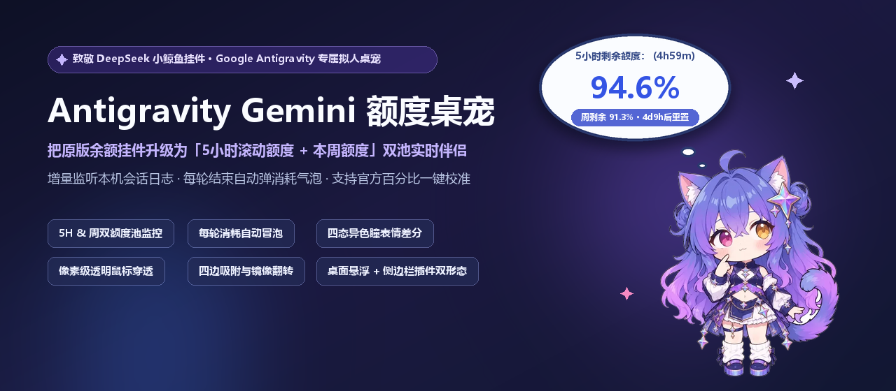
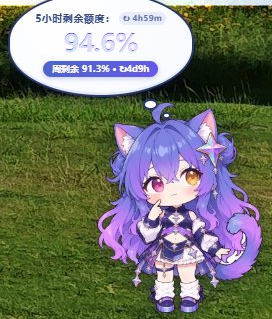
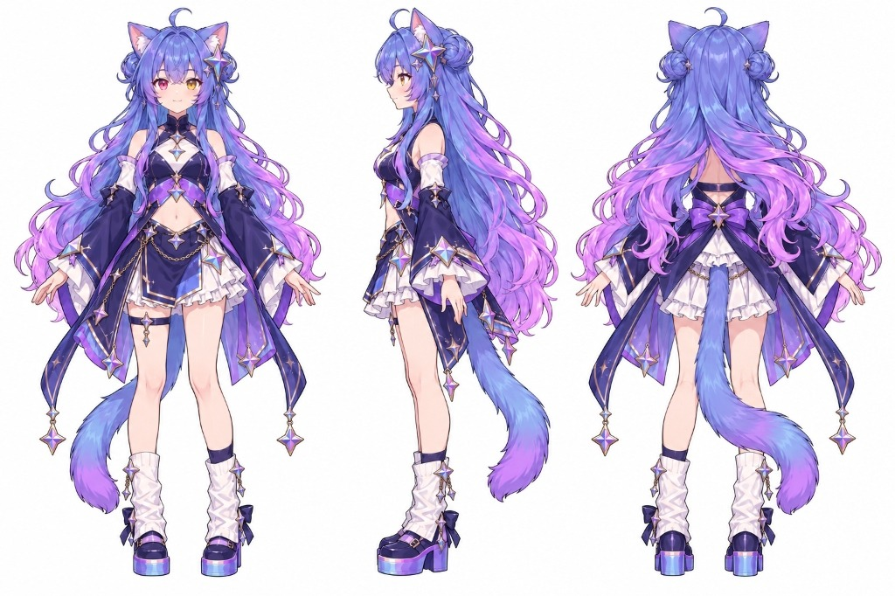
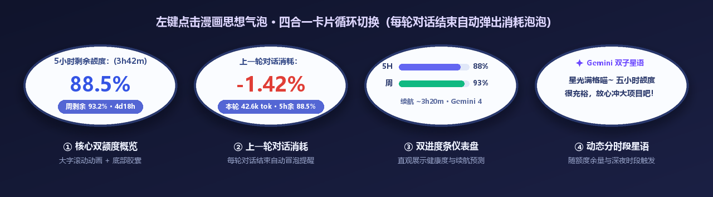
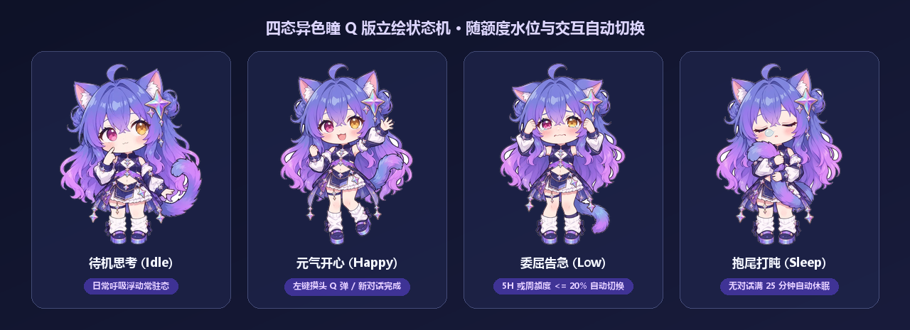
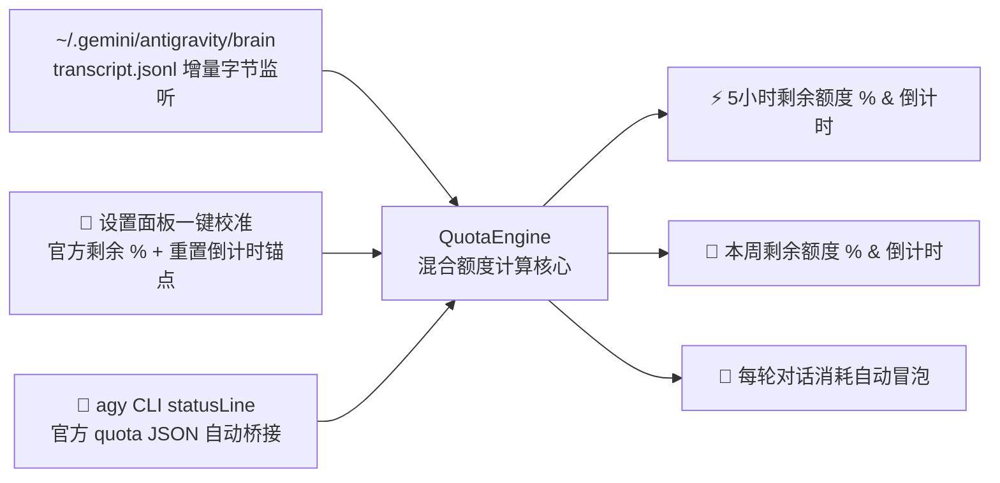

<div align="center">



<br />

# ✦ Antigravity Gemini 额度桌宠 (Gemini Quota Pet)

**专为 Google Antigravity 打造的双子星异色瞳猫娘陪伴桌宠**  
实时监控 **剩余 5小时滚动额度**、**本周总额度** 与 **每轮对话消耗** · 支持 **Windows 独立透明悬浮窗 + Antigravity 侧边栏插件** 双形态运行

🌐 **[English (Default)](README.md)** | **简体中文**

[](https://github.com/fornemadepi/Antigravity-Gemini-Quota-Pet)
[](https://antigravity.google)
[](https://www.electronjs.org/)
[](#-%E9%9A%90%E7%A7%81%E4%B8%8E%E5%AE%89%E5%85%A8%E8%AE%BE%E8%AE%A1)
[](LICENSE)

</div>

---

## ⚡ 最简获取方式（一句话交给 Antigravity 自动安装！）

无需手动敲命令 —— **直接复制下面这段话发送给你的 Antigravity，即可自动获得插件与桌面悬浮宠！**

```text
请帮我克隆 https://github.com/fornemadepi/Antigravity-Gemini-Quota-Pet.git ，安装依赖并运行 npm run install:plugin ，为我安装好 Gemini 额度桌宠插件与桌面启动器。
```

Antigravity 执行完成后，点击界面右上角辅助栏的 **`+` 号菜单 → 选择「Gemini 桌宠」** 即可在侧边栏常驻打开，面板内还可一键弹出独立透明的 Windows 桌面猫娘悬浮窗！

---

## 🌟 项目简介

在 **Google Antigravity** 开发环境中，模型使用采用 **「5小时活跃滚动额度（5-Hour Rolling Quota）+ 7天周基准额度（Weekly Quota）」** 双池共享机制。在沉浸式写代码时，频繁点开 `Settings → Models` 查看额度既打断心流，也很难直观感知单轮复杂任务消耗了多少配额。

为此，本项目以 **Gemini 双子星拟人化异色瞳猫娘** 为主角，为你提供漫画思想泡泡、每轮消耗自动提醒、Q 弹摸头反馈以及 **剩余 5小时 / 周额度** 实时监控陪伴体验：

<table>
<tr>
<td width="36%" align="center">
  
  <br />
  <sub><b>Windows 桌面透明无边框实机悬浮效果</b><br />（像素级透明鼠标穿透，绝不遮挡底层编辑器点击）</sub>
</td>
<td width="64%" align="center">
  
  <br />
  <sub><b>Gemini 异色瞳猫娘角色设定三视图</b><br />（粉金异色双瞳 · 四芒双子星发饰 · 渐变星云猫尾）</sub>
</td>
</tr>
</table>

---

## ✨ 核心功能亮点

### 1. 🫧 复刻经典漫画思想气泡 · 四合一卡片无缝切换

延续小鲸鱼挂件标志性的**白底深蓝描边椭圆气泡 + 双导引圆点**设计，左键点击气泡即可在 4 张实用数据与互动卡片间循环切换：

<p align="center">
  
</p>

- **① 核心双额度概览（默认主卡片）**：顶部显示主指标标题与紧凑重置倒计时，中央滚动大字展示 **5小时剩余额度 %**（随健康度自动由星辰蓝渐变为琥珀橙、告急红），底部蓝紫胶囊同步展示 **周剩余额度 %**（支持在设置中一键互换主副指标）。
- **② 上一轮对话消耗（自动冒泡提醒）**：增量监听本机 Antigravity 会话日志，每当一轮 Agent 思考/工具调用完成，**自动弹出本轮消耗百分比与 Token 明细**，伴随星光粒子与轻柔提示音，10 秒后自动切回主视图。
- **③ 双进度条与续航预测（Runway Forecast）**：同屏展示 `5H` 与 `周` 双向进度条、今日累计 Token 用量，并根据近 30 分钟消耗速率动态推算当前 5 小时窗口的剩余续航时长。
- **④ Gemini 双子星语互动**：根据当前剩余额度水位（充裕 / 过半 / 告急）以及深夜时段（23:00–05:00）触发不同性格的元气鼓励、省流提示或护眼关怀台词。

---

### 2. 🎭 四态异色瞳立绘状态机与 Q 弹桌面物理

<p align="center">
  
</p>

- **四态自动表情切换**：日常呼吸浮动保持「待机思考」；左键摸头或对话完成切换「元气开心」；当 **5小时或周额度 ≤ 20%** 时自动切换泪汪汪「委屈告急」提醒省流；超过 25 分钟无对话自动切换「抱尾打盹」（也可在右键菜单手动锁定任意表情）。
- **像素级鼠标穿透 + 零顶部白条**：基于离屏 Canvas 实时检测立绘像素透明度，空白透明区域 **100% 穿透点击**；同时利用 Win32 `setShape` 物理切除 Windows 11 DWM 非客户区，彻底杜绝失焦白条。
- **四边磁吸 & 左侧自动镜像翻转**：按住猫娘任意拖拽，松手靠近屏幕边缘自动吸附；当停靠在屏幕左侧时，猫娘自动水平镜像翻转面向工作区，气泡内收不裁切。
- **果冻 Q 弹按压 + 纯原生合成音效**：左键戳猫娘触发弹性挤压回弹、双子星漂浮粒子与 `Web Audio API` 实时合成的星光和弦音（零外部音频依赖，支持音量调节与静音）。

---

## 🧠 三合一混合额度引擎原理



1. **零配置开箱即用（本地滚动窗口模式）**：启动后增量读取 `~/.gemini/antigravity/brain/*/.system_generated/logs/transcript.jsonl`，按模型倍率与缓存权重实时推算过去 5 小时与 7 天窗口消耗。
2. **官方百分比一键锚点校准（推荐）**：右键桌宠打开「🎯 额度校准与设置面板」，对照 `Antigravity → Settings → Models` 填入一次当前 **5小时 / 周剩余百分比与重置倒计时**。此后每次对话会在该锚点上精准实时扣减；**当倒计时归零时，自动满血回满 `100%` 并顺延进入下一周期**！
3. **Antigravity CLI 免手填自动同步**：内置 `scripts/agy-statusline-bridge.js`，可在设置面板一键复制 `/statusline` 指令自动同步 CLI 官方 `quota` 字段。

---

## 🚀 手动安装与启动指南

### 环境要求
- 操作系统：**Windows 10 / 11**（macOS / Linux 亦可通过 `npm start` 运行）
- 运行环境：**[Node.js](https://nodejs.org/) 20 或更高版本**

```powershell
git clone https://github.com/fornemadepi/Antigravity-Gemini-Quota-Pet.git
cd Antigravity-Gemini-Quota-Pet
npm install
```

| 启动方式 | 操作方法 | 适用场景 |
| :--- | :--- | :--- |
| **方式 A：静默无黑框桌面悬浮宠（推荐）** | 双击根目录 **`启动桌宠(无黑框).vbs`**（可发送快捷方式至桌面或放入 `shell:startup` 开机自启） | 日常桌面陪伴、全局置顶或跟随 Antigravity 窗口 |
| **方式 B：常规批处理 / 命令行启动** | 双击 **`启动桌宠.bat`**（首次运行会自动装依赖）或运行 `npm start` | 首次快速体验或查看调试输出 |
| **方式 C：Antigravity 侧边栏原生插件** | 双击 **`安装Antigravity侧边栏插件.bat`** 或运行 `npm run install:plugin` | 在 Antigravity 右上角 **`+` 菜单 → Gemini 桌宠** 常驻打开，支持一键呼出桌面悬浮窗 |

---

## 🔒 隐私与安全设计

- **100% 纯本地运行，零联网遥测**：不连接任何第三方服务器，不收集任何用户行为数据。
- **只读分析 Token 元数据**：仅以只读方式统计本机 `transcript.jsonl` 中的模型名与 Token 计数，绝不读取或上传任何对话正文、API Key、Cookie 或账号登录凭据。

---

## 💖 致谢与鸣谢 (Acknowledgments)

本项目的创意灵感源自开源社区前辈们的精彩作品。以下名单整理自上游原版仓库官方 README 的「致谢」章节，在此向原程序作者及历代贡献者、支持者致以诚挚谢意：

- 🐋 **原版项目作者与灵感源头**：特别感谢 **月匠（[@MeteorNOX](https://github.com/MeteorNOX)）** 创作并开源了 **[MeteorNOX/DeepSeek-Balance-Whale-Widget](https://github.com/MeteorNOX/DeepSeek-Balance-Whale-Widget)**（DSH 小鲸鱼记账挂件），奠定了漫画思想泡泡、每轮消耗冒泡提示、Q 弹反馈与边缘吸附翻转的经典设计。
- 🖥️ **桌面端移植开拓与跨平台贡献**：
  - 感谢 **[@Yang-huai406](https://github.com/Yang-huai406)** 维护独立桌面仓库 **[Codex-Whale-Public](https://github.com/Yang-huai406/Codex-Whale-Public)** 并设计了严谨的余额校正与窗口跟随思路；
  - 感谢 **[@1llysviel](https://github.com/1llysviel)** 在上游 macOS 透明浮窗适配（PR [#128](https://github.com/MeteorNOX/DeepSeek-Balance-Whale-Widget/pull/128)）中的开拓贡献。
- 🛠️ **向原项目历代代码 PR 贡献者致敬**：
  - **[@ELFsay](https://github.com/ELFsay)**（多窗口订阅额度与重置倒计时展示设计，PR [#99](https://github.com/MeteorNOX/DeepSeek-Balance-Whale-Widget/pull/99)）
  - **[@Jy-EggRoll](https://github.com/Jy-EggRoll)**（任务状态响应与事件音效提示机制，PR [#161](https://github.com/MeteorNOX/DeepSeek-Balance-Whale-Widget/pull/161)）
  - **[@ztzpro](https://github.com/ztzpro)**（标准插件包架构改造，PR [#1](https://github.com/MeteorNOX/DeepSeek-Balance-Whale-Widget/pull/1)）
  - **[@under-the-ocean](https://github.com/under-the-ocean)**（自动化发布流水线，PR [#6](https://github.com/MeteorNOX/DeepSeek-Balance-Whale-Widget/pull/6) / [#7](https://github.com/MeteorNOX/DeepSeek-Balance-Whale-Widget/pull/7)）
  - **[@21253soursweetlemon](https://github.com/21253soursweetlemon)**（台词降级、边缘避让与锚点位置记忆系统起点，PR [#16](https://github.com/MeteorNOX/DeepSeek-Balance-Whale-Widget/pull/16) / [#18](https://github.com/MeteorNOX/DeepSeek-Balance-Whale-Widget/pull/18)）
  - **[@fangbm](https://github.com/fangbm)**（每轮消耗泡泡修复、多币种感知与自动发版日志，PR [#15](https://github.com/MeteorNOX/DeepSeek-Balance-Whale-Widget/pull/15) / [#19](https://github.com/MeteorNOX/DeepSeek-Balance-Whale-Widget/pull/19) / [#31](https://github.com/MeteorNOX/DeepSeek-Balance-Whale-Widget/pull/31) / [#33](https://github.com/MeteorNOX/DeepSeek-Balance-Whale-Widget/pull/33) / [#46](https://github.com/MeteorNOX/DeepSeek-Balance-Whale-Widget/pull/46)）
  - **[@xiaolinnnnnnn](https://github.com/xiaolinnnnnnn)**（Windows 桌面端技术探索，PR [#26](https://github.com/MeteorNOX/DeepSeek-Balance-Whale-Widget/pull/26)）
- 🤝 **向原项目社区测试、排障与安全反馈支持者致谢**：
  - 感谢 **[@yybai25](https://github.com/yybai25)**、**[@0Sakura721](https://github.com/0Sakura721)**、**[@VaeKaras](https://github.com/VaeKaras)**、**[@MengLs1620](https://github.com/MengLs1620)**，B 站用户 **「星丶白羽莲」**，以及所有在 Issue 区与 **QQ 交流群** 中热心提交复现分析、打磨细节与支持原版小鲸鱼成长的朋友们！

---

## 📄 开源许可与免责声明

- **源代码与文档**：基于 **[MIT License](LICENSE)** 开源。
- **角色美术素材**：按「原样（as-is）」随仓库提供，仅供运行与展示本桌宠挂件使用，不在 MIT 代码再许可范围内，详见 **[PROVENANCE.md](PROVENANCE.md)**。

> **⚠️ 兴趣创作与侵权联系声明**
>
> 本项目由本人和 **Antigravity** 完全凭借个人兴趣而创立（非商业性质爱好者项目）。如有侵权和其他不当行为，请通过本仓库 [Issue](https://github.com/fornemadepi/Antigravity-Gemini-Quota-Pet/issues) 联系作者进行整改和删除。
>
> *This project was created purely out of personal interest by the author together with Google Antigravity. If there is any copyright infringement or other inappropriate behavior, please contact the author via GitHub Issues for prompt rectification or removal.*
